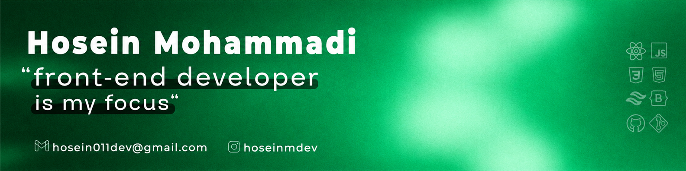

I build responsive web interfaces with React, Next.js, and TypeScript. I use Framer Motion for transitions and Axios to connect interfaces to APIs.

## Tech stack

**Languages**

**Frontend & routing**

**Motion & charts**

**State, forms & validation**

**APIs & databases**

**Build & version control**

